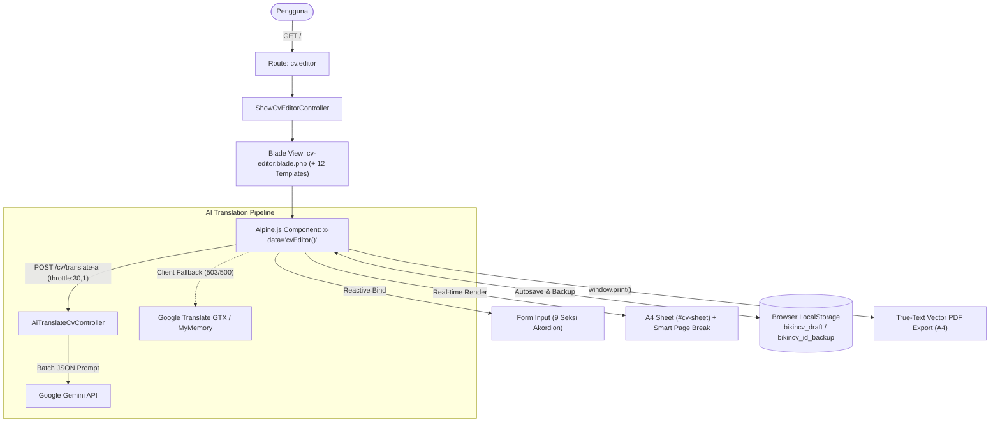
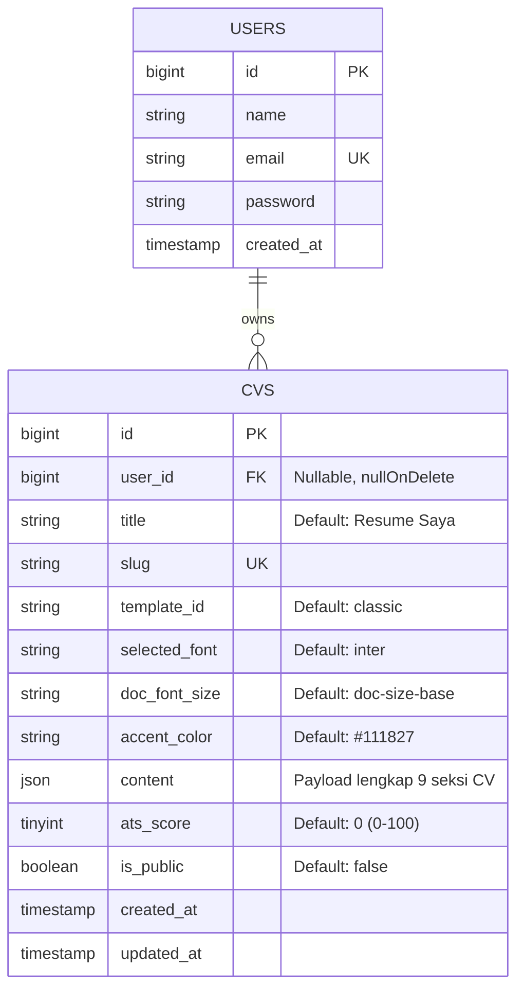

# Architecture & Database Design
## Project: BikinCV

---

## 1. Arsitektur Komponen: Privacy-First Blade + Alpine.js + AI Proxy

BikinCV menggunakan pendekatan **Server-Rendered Blade + Client-Side Reactive Alpine.js** dengan penyimpanan data pengguna 100% di sisi browser (`LocalStorage`) serta endpoint backend ringan untuk proxy terjemahan Google Gemini AI.



---

## 2. Skema Database (`cvs` & `users`)

Meskipun editor saat ini berjalan dalam mode **Privacy-First & Zero-Login** (rute `/login`, `/register`, `/dashboard`, `/cv/save` di-redirect ke `/`), skema tabel `cvs` tetap tersedia di database untuk kebutuhan seeder demo (`DemoCvSeeder`, `MultiPageCvSeeder`) dan referensi arsitektur cloud.



### 2.1 Indexing Strategis ([2026_10_25_000001_create_cvs_table.php](../database/migrations/2026_10_25_000001_create_cvs_table.php))
* `cvs(user_id, updated_at)`: Composite index untuk query daftar CV milik user tertentu (`Cv::scopeForUser()`).
* `cvs(slug)`: Unique index untuk memastikan keunikan slug dokumen.

---

## 3. Struktur JSON Payload (`cv` State & `cvs.content`)

Struktur data seragam yang digunakan oleh Alpine.js (`resources/js/app.js`), Ekspor/Impor JSON, proxy AI (`AiTranslateCvController`), serta seeder database (`DemoCvSeeder` & `MultiPageCvSeeder`):

```json
{
  "personal": {
    "fullName": "Budi Pratama",
    "jobTitle": "Senior Full Stack Software Engineer",
    "email": "budi.pratama@example.com",
    "phone": "+62 812-3456-7890",
    "location": "Jakarta, Indonesia",
    "linkedin": "linkedin.com/in/budipratama",
    "github": "github.com/budipratama",
    "website": "budipratama.dev",
    "photo": "",
    "summary": "Senior Software Engineer dengan 5+ tahun pengalaman dalam merancang dan mengembangkan aplikasi web berskala besar..."
  },
  "experiences": [
    {
      "id": "exp_1",
      "company": "PT Solusi Teknologi Nusantara",
      "position": "Lead Full Stack Engineer",
      "location": "Jakarta",
      "startDate": "Jan 2022",
      "endDate": "Sekarang",
      "isCurrent": true,
      "bullets": [
        "Merancang dan merekayasa ulang sistem pembayaran microservices yang memproses 500.000+ transaksi harian dengan uptime 99.98%.",
        "Mengoptimalkan throughput database MySQL dan mengurangi latensi query hingga 42%."
      ]
    }
  ],
  "educations": [
    {
      "id": "edu_1",
      "institution": "Universitas Indonesia",
      "degree": "Sarjana Komputer (S1 Teknik Informatika)",
      "location": "Depok, Jawa Barat",
      "startDate": "2015",
      "endDate": "2019",
      "gpa": "3.82 / 4.00"
    }
  ],
  "skills": {
    "languages": ["PHP 8.3", "JavaScript (ES6+)", "TypeScript", "SQL", "HTML5/CSS3"],
    "frameworks": ["Laravel", "Vue.js", "Alpine.js", "Tailwind CSS", "Node.js"],
    "databases": ["MySQL", "PostgreSQL", "Redis"],
    "tools": ["Git", "Docker", "AWS (EC2, S3)", "Postman", "Linux / Nginx"]
  },
  "certifications": [
    {
      "id": "cert_1",
      "name": "AWS Certified Solutions Architect – Associate",
      "issuer": "Amazon Web Services",
      "score": "890 / 1000",
      "issueDate": "Jan 2024",
      "expiryDate": "Jan 2027",
      "year": "2024"
    }
  ],
  "projects": [
    {
      "id": "proj_1",
      "name": "OpenResume - ATS Resume Engine",
      "role": "Creator & Maintainer",
      "link": "github.com/budipratama/open-resume",
      "description": "Platform open-source untuk validasi format dokumen resume terhadap standar parsing ATS."
    }
  ],
  "trainings": [
    {
      "id": "train_1",
      "institution": "Kementerian Komunikasi dan Digital (Digital Talent Scholarship)",
      "title": "Full Stack Web Developer Professional",
      "field": "Teknologi Informasi dan Komunikasi",
      "subField": "Web Development",
      "location": "Jakarta Selatan",
      "startDate": "Jul 2023",
      "endDate": "Okt 2023",
      "description": "Pelatihan intensif 300+ jam mencakup perancangan RESTful API, arsitektur database relasional, dan deployment aplikasi cloud."
    }
  ],
  "languages": [
    {
      "id": "lang_1",
      "name": "Bahasa Indonesia",
      "level": "Penutur Asli (Native)",
      "info": ""
    },
    {
      "id": "lang_2",
      "name": "Bahasa Inggris",
      "level": "Tingkat Kerja Profesional",
      "info": "TOEFL ITP: 600"
    },
    {
      "id": "lang_3",
      "name": "Bahasa Jepang",
      "level": "Tingkat Percakapan (Conversational)",
      "info": "JLPT N3"
    }
  ]
}
```

---

## 4. Mekanisme Cetak PDF ATS-Friendly (Client-Side Native)

Didefinisikan di [resources/css/app.css](../resources/css/app.css) untuk menghasilkan output PDF **100% vector text** dengan margin kertas A4 konsisten dan proteksi terhadap pemotongan elemen antar halaman:

```css
@media print {
    @page {
        size: A4 portrait;
        margin: 12mm 15mm 12mm 15mm;
    }

    .no-print,
    header.no-print,
    aside.no-print,
    nav.no-print,
    .mobile-tab-bar,
    [x-cloak] {
        display: none !important;
        visibility: hidden !important;
    }

    .zoom-viewport,
    #cv-sheet-scaler,
    #cv-sheet,
    .a4-sheet {
        display: block !important;
        width: 100% !important;
        box-shadow: none !important;
        border: none !important;
        transform: none !important;
        background: #ffffff !important;
    }

    h1, h2, h3, header {
        break-after: avoid !important;
        page-break-after: avoid !important;
    }

    .break-inside-avoid,
    article,
    li {
        break-inside: avoid !important;
        page-break-inside: avoid !important;
    }
}
```
