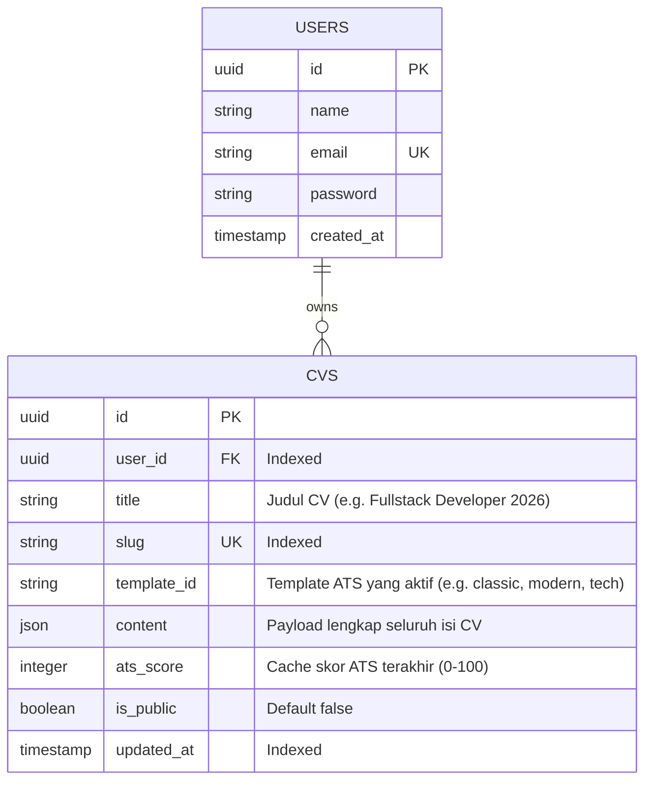

# Architecture & Database Design
## Project: BikinCV

---

## 1. Arsitektur Komponen: Blade + Alpine.js (Ultra-Lightweight)

Pendekatan yang dipilih adalah **Server-Rendered Blade + Client-Side Reactive Alpine.js**. 
Arsitektur ini memberikan kecepatan loading instan tanpa overhead bundle JavaScript besar (React/Vue build chain), sekaligus memberikan reaktivitas instan saat mengetik form.

```mermaid
graph TD
    User([Pengguna]) -->|Buka Halaman| Route[Route: GET /]
    Route --> Controller[ShowCvEditorController]
    Controller --> View[Blade View: cv-editor.blade.php]
    View --> Alpine[Alpine.js Component x-data='cvEditor()']
    Alpine -->|Reactive Bind| Form[Form Input Section]
    Alpine -->|Real-time Render| Preview[A4 Document Container]
    Alpine -->|Autosave| LocalStorage[(Browser LocalStorage)]
    Alpine -->|window.print()| PDF[True-Text PDF Export]
    
    subgraph Optional Cloud Sync
        Alpine -.->|Save to Cloud (Logged in)| Action[StoreCvAction / UpdateCvAction]
        Action -.-> DB[(Database: cvs)]
    end
```

---

## 2. Skema Database (Hybrid JSON, Ringan & Cepat)

Karena pengguna dapat menggunakan aplikasi sebagai **Guest First**, database hanya diakses ketika user ingin menyimpan CV secara permanen atau membuat banyak versi CV di akun mereka.



### 2.1 Indexing Strategis
* `cvs(user_id, updated_at DESC)`: Composite index untuk memuat daftar CV user secara cepat di dashboard.
* `cvs(slug)`: Unique index jika CV ingin dibagikan via URL publik.

---

## 3. Struktur JSON Payload (`cvs.content`)

Seluruh data section CV dikemas dalam satu objek JSON terstruktur:

```json
{
  "personal": {
    "full_name": "Budi Pratama",
    "job_title": "Senior Backend Developer",
    "email": "budi@example.com",
    "phone": "+62 812-3456-7890",
    "location": "Jakarta, ID",
    "linkedin": "linkedin.com/in/budipratama",
    "github": "github.com/budipratama",
    "website": "budipratama.dev",
    "summary": "Software engineer dengan pengalaman 5+ tahun membangun sistem backend berkinerja tinggi..."
  },
  "experiences": [
    {
      "id": "exp_1",
      "company": "PT Solusi Teknologi",
      "position": "Backend Engineer",
      "location": "Jakarta",
      "start_date": "2022-01",
      "end_date": "Present",
      "is_current": true,
      "bullets": [
        "Meningkatkan throughput API sebesar 45% menggunakan Redis caching.",
        "Merancang database schema MySQL yang menangani 1 juta transaksi per hari."
      ]
    }
  ],
  "educations": [
    {
      "id": "edu_1",
      "institution": "Universitas Indonesia",
      "degree": "S1 Teknik Informatika",
      "start_year": "2017",
      "end_year": "2021",
      "gpa": "3.85"
    }
  ],
  "skills": {
    "technical": ["PHP 8.3", "Laravel", "MySQL", "Redis", "Docker", "Git"],
    "soft": ["Problem Solving", "Team Leadership", "Agile/Scrum"]
  },
  "certifications": [
    {
      "id": "cert_1",
      "name": "AWS Certified Solutions Architect",
      "issuer": "Amazon Web Services",
      "issue_year": "2024"
    }
  ]
}
```

---

## 4. Mekanisme Cetak PDF ATS-Friendly (Client-Side Native)

Menggunakan standar cetak CSS murni untuk menghasilkan output PDF yang **100% vector text** (dapat di-copy, diindeks mesin ATS, dan tajam saat dicetak):

```css
@media print {
    /* Sembunyikan elemen navigasi dan form input */
    .no-print, header, nav, .editor-panel {
        display: none !important;
    }

    /* Pastikan lembar preview mengisi penuh halaman A4 */
    body {
        background: white !important;
        margin: 0 !important;
        padding: 0 !important;
    }

    .cv-sheet {
        box-shadow: none !important;
        margin: 0 !important;
        width: 100% !important;
        min-height: 100vh !important;
        page-break-after: avoid;
    }

    @page {
        size: A4 portrait;
        margin: 12mm 15mm 12mm 15mm;
    }
}
```
